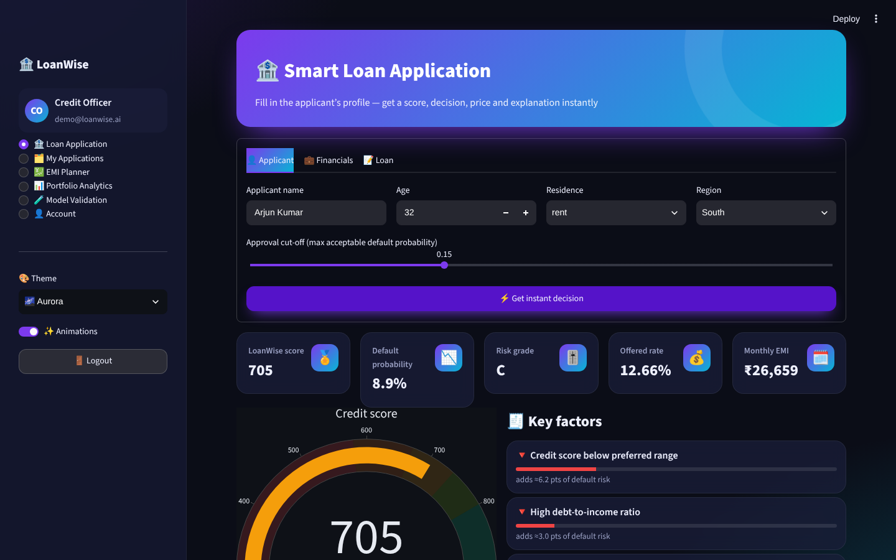
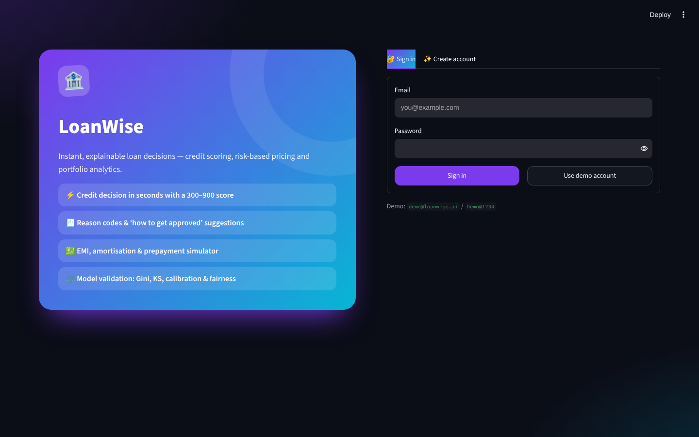
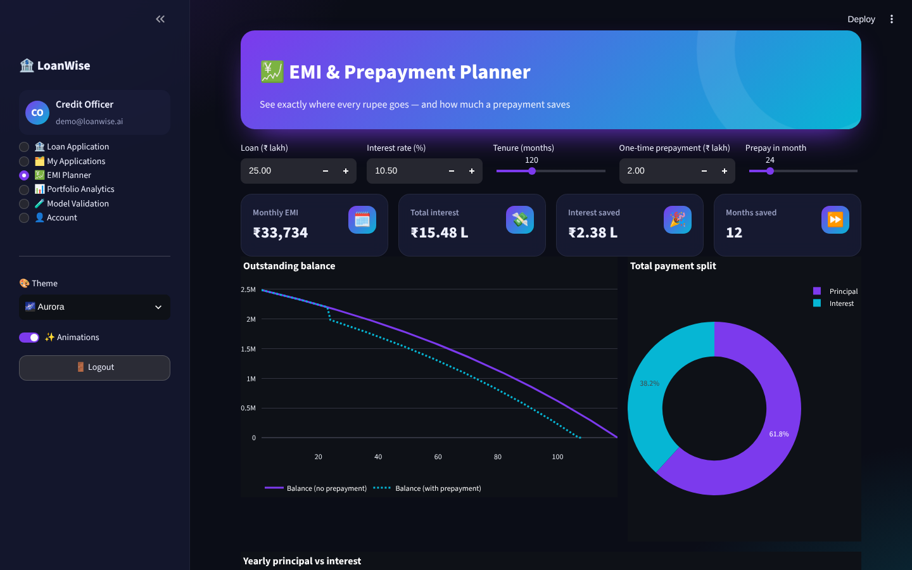
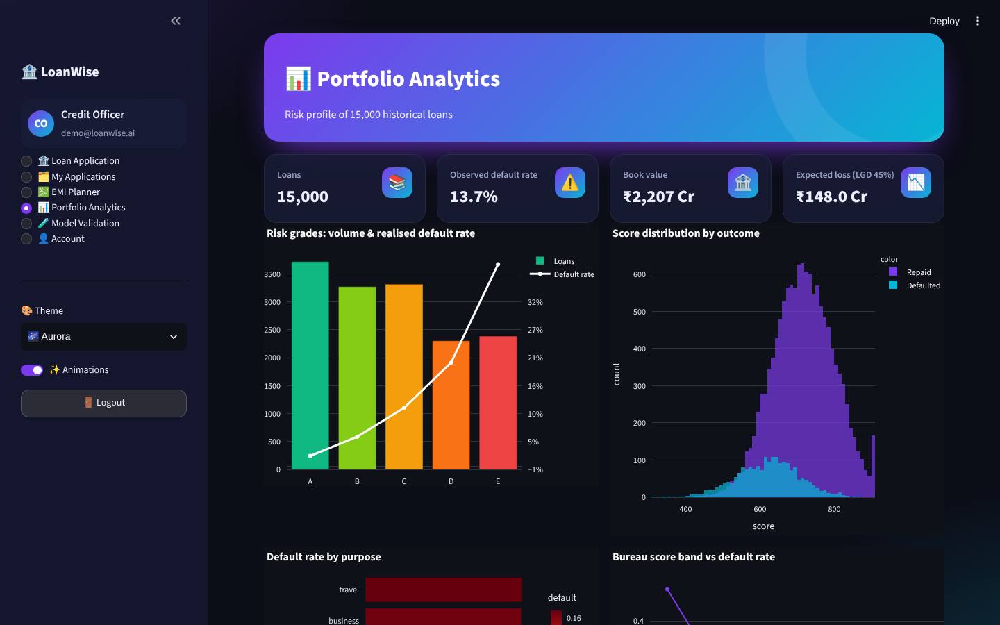
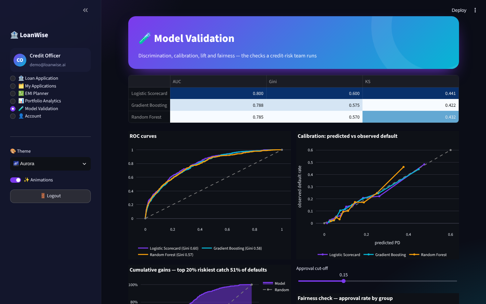
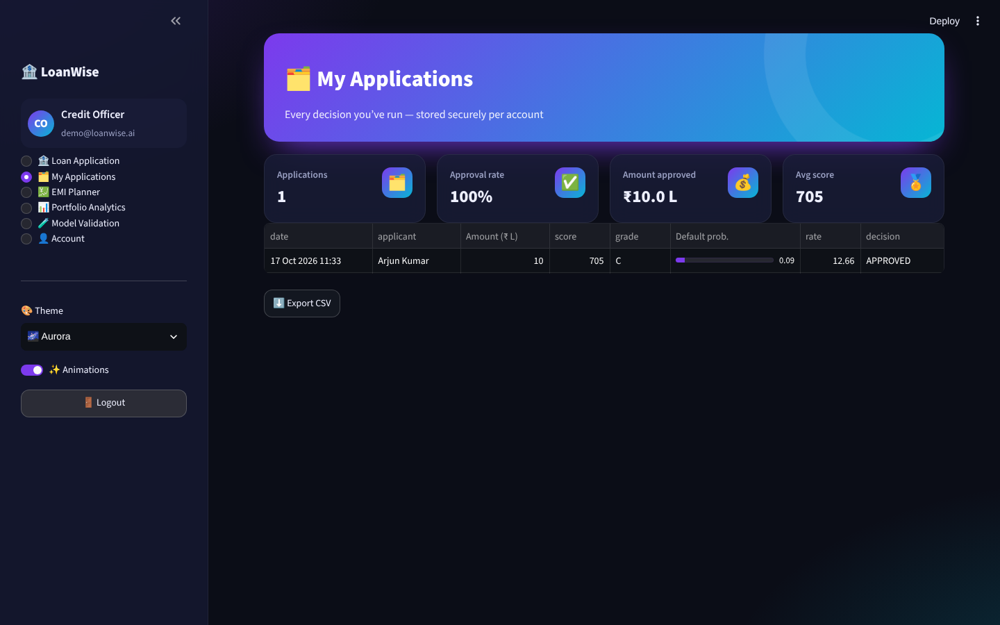

<div align="center">

# 🏦 LoanWise

### AI credit-risk scoring & smart loan approval — instant 300–900 score, risk-based pricing, reason codes, EMI planner and model validation


</div>



## ✨ Features

| Module | Highlights |
|---|---|
| 🔐 **Register / Login** | SQLite users, salted **PBKDF2-SHA256** hashing, strength meter, validation, demo account, activity log, change password |
| 🏦 **Loan Application** | Tabbed application form (applicant · financials · loan), adjustable approval cut-off and model → **LoanWise score (300–900)**, default probability, risk grade A–E, **risk-based interest rate**, EMI, post-loan DTI, APPROVED / CONDITIONAL / DECLINED decision, **reason codes**, and **counterfactual tips** (“reduce the loan to ₹X L or raise your score to Y”) |
| 🗂️ **My Applications** | Per-user decision history (SQLite) with KPIs and CSV export |
| 💹 **EMI Planner** | EMI, total interest, principal/interest split, yearly breakdown, **prepayment simulator** (interest & months saved), full amortisation schedule |
| 📊 **Portfolio Analytics** | 15,000-loan book: risk grades vs realised default, score distributions, default by purpose and bureau score band, **expected loss** |
| 🧪 **Model Validation** | Logistic scorecard vs Gradient Boosting vs Random Forest — AUC, **Gini, KS**, ROC, **calibration curves**, cumulative gains, **fairness check** (approval rates by region & age band, four-fifths rule) |
| 🎨 **Themes & animations** | 5 colour themes, glassmorphism cards, animated hero, page transitions, balloons on approval, animation toggle |

## 🧠 How it works

* **Data** – 15,000 synthetic Indian retail-loan applications (income in ₹ lakh, bureau score, DTI, loan-to-income, tenure, late payments, employment, residence, purpose, region) with defaults drawn from a realistic logistic risk model (~14 % default rate).
* **Models** – one-hot + scaled features feeding a logistic **scorecard**, HistGradientBoosting and Random Forest.
* **Scoring** – PD is mapped to a 300–900 scale with *points-to-double-odds* = 50.
* **Pricing** – base rate + expected-loss premium + risk margin, capped at 24 %.
* **Explainability** – reason codes measure how much each adverse factor adds to PD; counterfactuals search the smallest loan amount / score that would pass the cut-off.

## 🖼️ Screenshots

| Login | EMI planner | Portfolio analytics |
|---|---|---|
|  |  |  |

| Model validation | My applications |
|---|---|
|  |  |

## 🚀 Run locally

```bash
git clone https://github.com/PreciousBharath/LOANWISE-CREDIT-RISK-SCORING.git
cd LOANWISE-CREDIT-RISK-SCORING
pip install -r requirements.txt
streamlit run app.py
```

Click **Use demo account** (`demo@loanwise.ai` / `Demo@1234`) or create an account.

## 🧱 Project structure

```
├── app.py              # Streamlit pages
├── core/
│   ├── engine.py       # loan book generator, models, scorecard, pricing, reason codes, counterfactuals, EMI, history
│   ├── auth.py         # SQLite users, PBKDF2 hashing, login/register UI
│   └── ui.py           # themes, animations, KPI cards, Plotly template
├── .streamlit/config.toml
└── requirements.txt
```

> Educational project — not financial advice or a real lending system.

## 📄 License

MIT © [Bharath](https://github.com/PreciousBharath)
